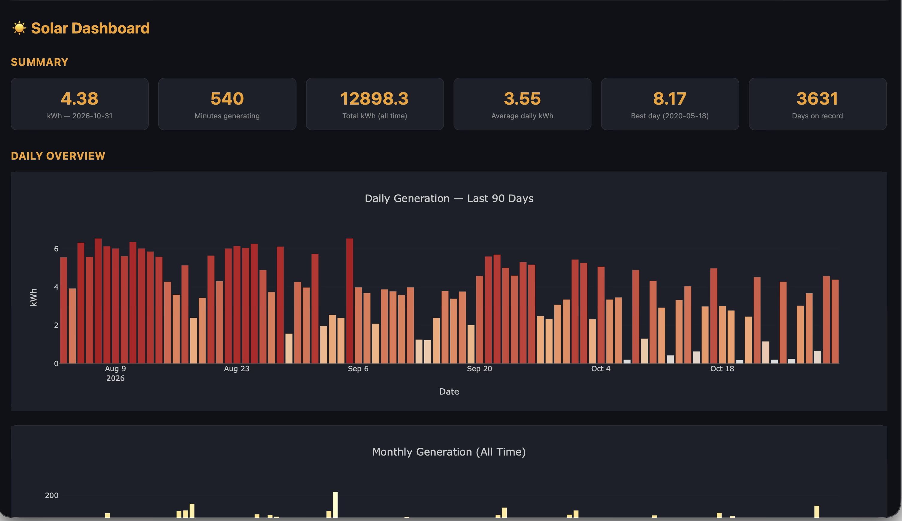
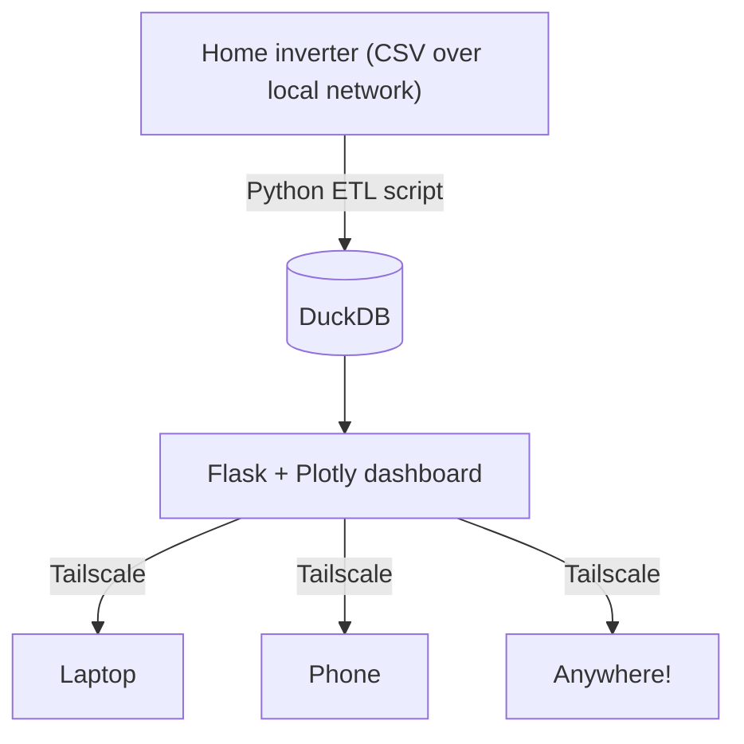

# Solar Panel Data Pipeline and Dashboard

An ETL pipeline and dashboard that collects data from a home solar inverter, stores it in DuckDB and visualises generation over time.



*Current dashboard: summary cards and daily generation over the last 90 days.*

## Motivation

The pipeline was built to provide an easy, reliable way to view home solar generation from anywhere, for an inverter with no first-party application or support. Developing it also improved my skills in ETL pipelines, local networking, and the full end-to-end deployment and maintenance of a project.

## Overview



* **ETL:** a batch script, scheduled to run daily, fetches CSV data from the inverter and loads it into two DuckDB tables: `daily_data` (kWh generated per day) and `five_min_data` (kWh generated per 5-minute window). Only rows newer than the latest stored record are loaded, and a `TABLE_CONFIG` dictionary holds everything that differs between the two tables.

* **Dashboard:** summary cards show key figures such as the most recent day, minutes generating, total and average daily generation, and the best day. Overview charts show the previous 90 days and longer-term trends (monthly totals and a 30-day rolling average). A drop-down lets you view generation in 5-minute windows for any selected day.

* **Tests:** unit tests (pytest) cover the pipeline's filtering logic, including handling of unparseable dates and excluding the current, incomplete day.

## Tech Stack

* Python
* SQL
* pandas
* requests
* DuckDB
* Flask
* Plotly
* pytest
* python-dotenv
* Tailscale

## Project Structure

```text
solar-pipeline/
├── README.md
├── .gitignore
├── .env.example
├── dashboard_screenshot.png
├── etl/
│   ├── pipeline.py              # fetch inverter CSVs and load into DuckDB
│   ├── conftest.py              # pytest configuration
│   ├── requirements.txt
│   └── tests/
│       └── test_pipeline.py     # unit tests for the filtering logic
└── dashboard/
    ├── app.py                   # Flask app and Plotly charts
    ├── requirements.txt
    ├── templates/index.html
    └── static/plotly.min.js
```

## Getting Started

**Prerequisites:** Python 3, and an inverter on your local network that serves its data as CSV.

1. Clone the repository and create a virtual environment:

   ```bash
   git clone https://github.com/Amiddlemiss3/solar-pipeline.git
   cd solar-pipeline
   python3 -m venv .venv
   source .venv/bin/activate
   ```

2. Install the dependencies for both components:

   ```bash
   pip install -r etl/requirements.txt -r dashboard/requirements.txt
   ```

3. Copy `.env.example` to `.env` and fill in your inverter address, database path and log file paths:

   ```bash
   cp .env.example .env
   ```

4. Run the pipeline to fetch the latest data:

   ```bash
   python etl/pipeline.py
   ```

5. Start the dashboard, then open `http://localhost:8080` in a browser:

   ```bash
   python dashboard/app.py
   ```

6. Run the tests:

   ```bash
   cd etl
   pytest
   ```

## Roadmap

Upcoming improvements:

* Migrate the pipeline and dashboard to a Raspberry Pi
* Containerise with Docker
* Add CI with GitHub Actions to run the tests on every push, and expand test coverage
* Dashboard improvements:
    * Manual update of data from within the dashboard
* **dbt transformation layer:** move the dashboard's aggregations (daily and monthly totals, year-to-date generation, best day, estimated earnings) out of Python and into dbt models running on DuckDB via `dbt-duckdb`, with data tests on the raw and staging tables. At this scale the transformations are simple, so this is mainly to learn dbt and to give the project a clearer separation between ingestion and transformation, tested SQL models and generated documentation.
